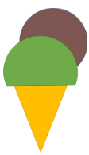

> [!IMPORTANT]
> В задачите се очаква да използвате материала изучаван до момента - if/else/switch и цикли.

## Задача 0

Нека проверим какво сте запомнили от материала до момента. Каква ще е стойността на променливите?

```cpp
// ------------ Question 1 ------------
    int res = 0 / 0;

// ------------ Question 2 ------------
    float res = 0.0 / 0.0;
    float res = 0.0 / -0.0;

// ------------ Question 3 ------------
    float res = 1.0 / 0.0;
    float res = 1.0 / -0.0;

// ------------ Question 4 ------------
    double res = 0.1 + 0.1;

// ------------ Question 5 ------------
    unsigned int res = 0 - 1;

// ------------ Question 6 ------------
    int x = 4;
    int res = 2 * x++ * 10 / x;

// ------------ Question 7 ------------
    int x = 1;
    int res = 2 * (x++, x--) - (10 * --x);

// ------------ Question 8 ------------
    int number_one, number_two, number_three;
    number_one = number_two = number_three = 3;
```

## Задача 1

Да се въведат от клавиатурата две произволни естествени числа, да речем x и y. Разменете стойностите им:

1. Посредством трета променлива
2. Посредством аритметични операции.

```
Примерен вход и изход:

x = 2 --> x = 3
y = 3 --> y = 2
```

## Задача 2

 По въведена година проверете дали тя е високосна.

>  Спрямо Григорианския календар, година е високосна, ако се дели на 4, с изключение на тези, които се делят на 100, но не и на 400.

```
Примерен вход:
2024, 1800, 2400

Примерен изход:
2024 1
1800 0 // 1800 % 4 =0, но 1800 % 100 = 0 и 1800 % 400 != 0
2400 1 // 2400 % 4 = 0, 2400 % 100 = 0 и 2400 % 400 = 0, така че е високосна
```

## Задача 3

Да се въведат трите страни на триъгълник и да се изведе дали съществува триъгълник с такива страни.

```
Примерен вход: 4, 5, 7
Изход: Има такъв
```

## Задача 4

Създайте програма, която прочита от стандартния вход стойностите на три цели числа и извежда на стандартния изход броя на положителните числа и броя на отрицателните числа като отделни резултати, измежду въведените три цели числа.

```
Вход: 1 -2 3

Изход:
Positive: 2
Negative: 1
```

## Задача 5 (КР)

Дадени са ви две валидни точки от шахматна дъска (x1,y1), (x2,y2). Проверете дали може да се достигне от първата до втората точка с един ход на:

* кон
* цар
* топ
* царица
* офицер  

За улеснение считайте, че дъската има клетки с координати, подобно на Декартова КС, като започвате да броите от (0,0)

```
#Пример
Вход:
0 0 1 2

Horse: 1
Bishop: 0
Tower: 0

Tower: 0
King: 0
Queen: 0
```

## Задача 6

Дадени са 4 цели числа A, B, C и D. Да се намери сумата на двата края на сечението на [A, B] и [C, D].
(−1018 <= 𝐴 <= 𝐵 ; 𝐶 <= 𝐷 <= 1018)

```
#Примери

Вход  
2 8  
-7 5  
Изход  
7 --> [2,8] ^ [-7,5] = [2,5] 
Вход  
0 18  
22 22  
Изход  
0
Вход  
1 8  
2 7
Изход  
9 --> [2,7]
```

## Задача 7

Дадена е декартова координатна система. Всеки правоъгълник със страни успоредни на координатните оси в нея може да се определи с четири числа с плаваща точка: координатите на долния си ляв ъгъл (x, y), ширината и дължината си. Напише програма, която прочита от стандартния вход данни за два правоъгълника и извежда на екрана дали се пресичат

> Жокер: използвайте логиката от задача 6

```
#1 Пример
Вход:
0 0 5 3
4 1 3 3

Изход:
1

#2 Пример
Вход:
0 0 2 2
-1 -1 1 1

Изход:
0
```

## Задача 8

Да се напише програма, която прочита от стандартния вход радиус на окръжност r, с център (0,0) и точка - px, py. Определете дали точката се намира вътре, върху или извън окръжността.

```
#1 Пример
Вход:
5 5
10

Изход:
Inside:      1
On border:   0
Outside:     0

#2 Пример
Вход:
5 2
4

Изход:
Inside:      0
On border:   0
Outside:     1

#3 Пример
Вход:
1 1
1.414214

Изход:
Inside:      1
On border:   0
Outside:     0
```

## Задача 9

Прочетете от конзолата:

1) Окръжност, представена като (radius, xCenter, yCenter)

2) Правоъгълник, успореден на координатните оси, представен като (x1, y1, x2, y2).Където (x1, y1) са координатите на долния ляв ъгъл, а (x2, y2) — на горния десен ъгъл.

Изведете на конзолата дали окръжността и правоъгълника имат обща част!

```
#Пример 1
Вход:
Insert Circle params (radius, x, y): 1 0 0
Insert rectangle params (point 1, point2): 1 -1 3 1
Output: true
Обяснение: Кръгът и правоъгълника споделят точка (1,0).

#Пример 2
Вход:
Insert Circle params (radius, x, y): 1 1 1
Insert rectangle params (point 1, point2): 1 -3 2 -1
Output: false
```


## Задача 10

Да се напише програма, която въвежда координатите на точка и проверява дали тя се съдържа във фигурата:

<div align="center"></img></div>

## Задача 11 (KР)

Да се напише програма, която въвежда координатите на точка и проверява дали тя се съдържа във фигурата:

<div align="center"></img></div>

## Задача 12 (КР)



Напишете програма, която по дадена точка с реални координати, въведени от
стандартния вход, определя дали точката принадлежи на "вафлената" фуния, на
"топката ментов сладолед" или на "топката шоколадов".

Фунията се определя от координатите на точките (-1, -2), (5, -2) и (2, -10).
Топката ментов сладолед се определя от окръжност с център (2, 0) и радиус 4.
Топката шоколадов сладолед се определя от окръжност с център (4, 4) и радиус 4.

<br clear="left">
