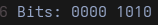
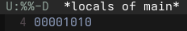
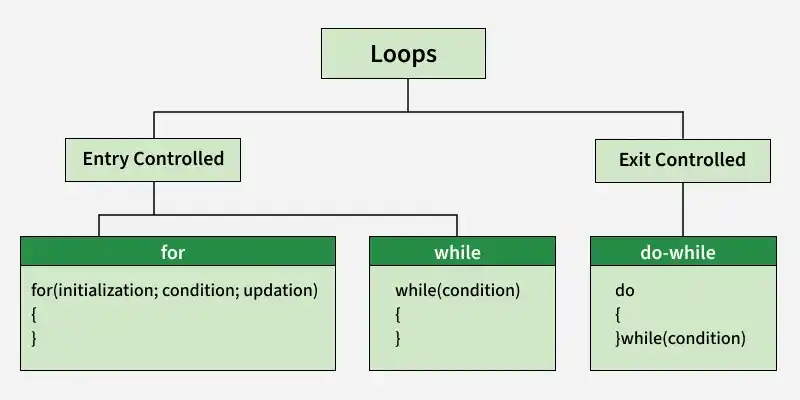

# Цикли в C

Циклите позволяют един и същ блок код да се изпълнява многократно, докато е изпълнено дадено условие. Благодарение на тях не се налага да повтаряме един и същ код ръчно, а програмите стават по-кратки, по-четими и по-гъвкави.

## Идея на циклите

Да вземем следната задача:

> Принтирайте двоичното представяне на 8-битово число.

### Наивен подход

Без цикли трябва да извлечем всеки бит поотделно:

```c
#include <stdio.h>

int main(void)
{
    unsigned char num = 10;

    int b1 = (num >> 0) & 1;
    int b2 = (num >> 1) & 1;
    int b3 = (num >> 2) & 1;
    int b4 = (num >> 3) & 1;
    int b5 = (num >> 4) & 1;
    int b6 = (num >> 5) & 1;
    int b7 = (num >> 6) & 1;
    int b8 = (num >> 7) & 1;

    printf("Bits: %d%d%d%d %d%d%d%d\n", b8, b7, b6, b5, b4, b3, b2, b1);
    return 0;
}
```



Осемте реда се различават само по това колко позиции отместваме. При 32- или 64-битово число този подход става неизползваем.

### Решение с цикъл

```c
#include <stdio.h>

int main(void)
{
    unsigned char num = 10;

    for (int i = sizeof(num) * 8 - 1; i >= 0; --i)
    {
        printf("%d", (num >> i) & 1);
    }

    return 0;
}
```



Повтарящото се действие е написано **веднъж**. Ако сменим типа на `num`, кодът продължава да работи без промени.

---

## Типове цикли

Циклите в **C** се разделят да два типа спрямо обработката на условията си - **Entry Controlled** и **Exit Controlled**.

* Entry Controlled - for и while
* Exit Controlled  - do...while

<div align="center">  </div>

---

## `while`

Изпълнява тялото, **докато** условието е истина. Условието се проверява преди всяка итерация.

```c
while (condition)
    statement
```

- **condition** – израз, който се оценява до `0` (лъжа) или `!= 0` (истина).
- **statement** – тялото на цикъла: един оператор или блок `{ }`.

**Пример:**

```c
int i = 1;
while (i <= 5) {
    printf("%d ", i);
    i++;
}
// 1 2 3 4 5
```

<details>
<summary><b>Как работи <code>while</code> „под капака“?</b></summary>

Цикълът е еквивалентен на следната конструкция с `goto`:

```c
while_start:
    if (condition) {
        statement
        goto while_start;
    }
```

</details>

> [!IMPORTANT]
> Променливите, декларирани в тялото, се създават наново на всяка итерация и се унищожават в края ѝ. Те **не** запазват стойността си между итерациите.

---

## `for`

Също е entry controlled, но събира инициализацията, условието и стъпката на едно място. Затова е удобен, когато знаем колко пъти искаме да повторим нещо.

```c
for (init-statement; condition; expression)
    statement
```

| Част | Кога се изпълнява | Обикновено служи за |
|---|---|---|
| `init-statement` | веднъж, в началото | деклариране на брояч: `int i = 0` |
| `condition` | преди всяка итерация | проверка: `i < n` |
| `expression` | след всяка итерация | стъпка: `i++` |
| `statement` | на всяка итерация | тялото на цикъла |

### Ред на изпълнение

1. `init-statement` (само веднъж)
2. `condition`: ако е лъжа, цикълът приключва
3. `statement`
4. `expression`
5. обратно към стъпка 2

### Подробности

**`init-statement`**
- Променлива, декларирана тук, е видима **само в цикъла**.
- Може да декларираме няколко променливи от един тип: `for (int i = 0, j = 10; ...)`.
- Може да е празен, ако броячът е деклариран преди цикъла: `for (; i < 5; i++)`.

**`condition`**
- Ако е лъжа още в началото, тялото не се изпълнява нито веднъж.
- Ако е празен, се смята за истина и цикълът става безкраен: `for (;;) { ... }`.

**`expression`**
- Може да съдържа няколко израза, разделени със запетая: `i++, j--`.
- Може да е празен, ако броячът се променя в тялото.

<details>
<summary><b>Как работи <code>for</code> „под капака“?</b></summary>

`for` е почти еквивалентен на:

```c
{
    init-statement;
    while (condition) {
        statement
        expression;
    }
}
```

Има една разлика: при `continue` във `for` цикъл `expression` **се изпълнява**, докато в горния `while` би се пропуснал.

</details>

> [!WARNING]
> Точка и запетая след скобите създава цикъл с **празно тяло**:
> ```c
> for (int i = 0; i < 5; i++);   // ← тук цикълът свършва
>     printf("Hello\n");         // изпълнява се само веднъж
> ```

---

## `do...while`

Единственият **exit controlled** цикъл в C. Тялото се изпълнява първо, а условието се проверява след него. Затова тялото **винаги се изпълнява поне веднъж**.

```c
do
    statement
while (condition);
```

- **statement** – тялото на цикъла: един оператор или блок `{ }`.
- **condition** – проверява се **след** всяка итерация.

> [!NOTE]
> `;` след `while (condition)` е **задължителна**.

### Ред на изпълнение

1. `statement`
2. `condition`: ако е лъжа, цикълът приключва
3. обратно към стъпка 1

> [!WARNING]
> Променлива, декларирана в тялото, **не се вижда** в условието:
> ```c
> do {
>     int x = read();
> } while (x != 0);   // грешка: x не е видима тук
> ```
> Декларирайте я преди `do`.

---

## `break` и `continue`

Тези оператори променят нормалния ход на изпълнението вътре в цикъл.

| Оператор | Действие |
|---|---|
| `break` | излиза **веднага** от цикъла |
| `continue` | пропуска остатъка от текущата итерация и преминава към следващата |

### `break`

Прекратява **най-вътрешния** цикъл (или `switch`), в който се намира. За разлика от някои други езици, в C не можем да излезем от няколко вложени цикъла наведнъж.

```c
for (int i = 0;; ++i)
{
    if (i == 13) {
        printf("Unlucky number\n");
        break; 
    }
}
```

### `continue`

Прескача до края на текущата итерация:

- при `for` се изпълнява `expression` и след това се проверява условието;
- при `while` и `do...while` директно се проверява условието.

```c
for (int i = 0; i < 20; ++i)
{
    if (i % 2 == 0)
        continue;   // прескачаме четните

    printf("%d ", i);
}
// 1 3 5 7 9 11 13 15 17 19
```

---

## Източници

- [`while` loop – cppreference](https://en.cppreference.com/w/c/language/while)
- [`for` loop – cppreference](https://en.cppreference.com/w/c/language/for)
- [`do-while` loop – cppreference](https://en.cppreference.com/w/c/language/do)
- [`break` – cppreference](https://en.cppreference.com/w/c/language/break)
- [`continue` – cppreference](https://en.cppreference.com/w/c/language/continue)
